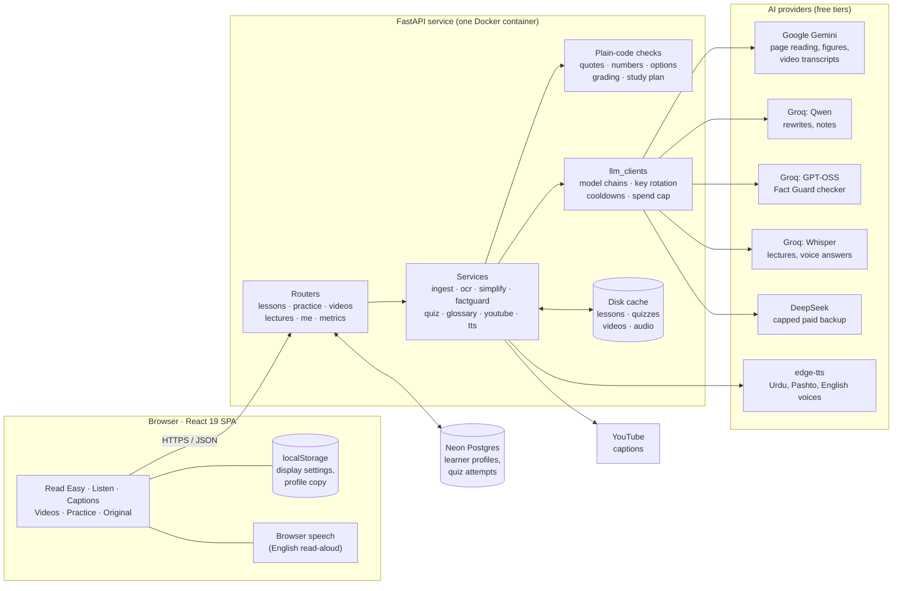
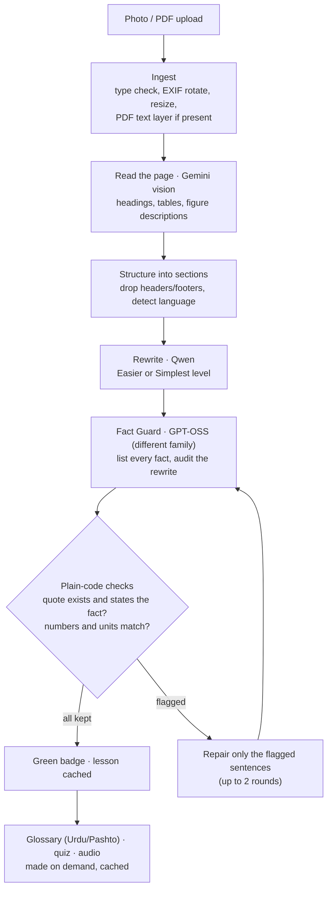

# Roshni · روشنی

### One page. Every learner.

Roshni turns a photo of any printed page, a lecture recording or a YouTube video into an accessible lesson for **blind, dyslexic, deaf and Urdu/Pashto-medium learners**. A second AI, **Fact Guard**, checks that no fact was lost, changed or invented along the way.

**AICON'26 Build With AI** · Domain: **EdTech & Workforce** · Team: **404 Team Not Found**

| | |
|---|---|
| **Live app** | _Render link added after deployment_ |
| **Demo deck** | [`slides/Roshni-AICON26-Demo.pptx`](slides/Roshni-AICON26-Demo.pptx) (5 minutes, script in [`docs/DEMO.md`](docs/DEMO.md)) |
| **Evidence** | [Measured results](#5-evidence), all reproducible from [`eval/`](eval) |

---

## Contents
1. [The problem](#1-the-problem)
2. [The solution](#2-the-solution)
3. [Features](#3-features)
4. [System design](#4-system-design)
5. [Evidence](#5-evidence)
6. [Tech stack](#6-tech-stack)
7. [Run it locally](#7-run-it-locally)
8. [Deployment](#8-deployment)
9. [Project structure](#9-project-structure)
10. [Hackathon checklist](#10-hackathon-checklist)
11. [Limitations and next steps](#11-limitations-and-next-steps)
12. [Team and credits](#12-team-and-credits)

---

## 1. The problem
One printed page fails three students in the same class:

| Learner | Why the page fails them |
|---|---|
| **Blind or low-vision** | Can't read the text or see the diagrams. |
| **Dyslexic, weaker readers, Urdu/Pashto-medium students** | Long sentences and hard English words lose them. |
| **Deaf or hard of hearing** | Miss the teacher's spoken explanation of the page. |

A teacher has no time to adapt every page three ways, so it doesn't happen. About **1 in 6 people** live with a significant disability (WHO, 2023). And simplifying text with ordinary AI is risky: it can quietly drop a fact or change a number, and a struggling learner can't tell.

## 2. The solution
**Input:** a phone photo, scan or PDF of any page (a textbook, a training manual, a safety notice, a worksheet), a lecture recording, or a YouTube link.

**Output:** one lesson, opened the way each learner needs it, with every rewrite and note checked by Fact Guard.

| Mode | For | What it gives |
|---|---|---|
| **Read Easy** | Dyslexic and weaker readers, Urdu/Pashto-medium learners | Simpler text beside the original, read-aloud with sentence highlighting, hard words explained in Urdu or Pashto with audio, "ask about this sentence" |
| **Listen** | Blind and low-vision learners | Section-by-section audio, every figure described in words, full keyboard and screen-reader control |
| **Captions** | Deaf and hard-of-hearing learners | Lecture transcript synced to the audio, plus a summary checked against what was said |
| **Videos** | Anyone revising | YouTube video → timestamped study notes, each checked against the video |
| **Practice** | Everyone, including blind learners by voice | Up to 15 questions from verified facts, voice answers, a timer, weak areas and a study plan |

**SDG impact:** 4.5 (equal access to education for persons with disabilities), 4.1 (quality education), 10.2 (inclusion).

## 3. Features

### Fact Guard: why a rewrite can be trusted
1. **Independent checker.** A model from a *different family* than the rewriter lists every fact on the original page and audits the rewrite. The code refuses a same-family checker.
2. **Quote or it didn't happen.** A fact counts as kept only if the checker quotes it from the rewrite, and plain code confirms the quote exists and states the fact.
3. **Both directions.** Missing or changed facts, and claims the rewrite invented.
4. **Numbers checked by plain code.** Numbers, units, formulas and symbols are compared without AI (`50 min` can never become `100 min`).
5. **Repair, then re-check.** Only flagged sentences are rewritten, up to two rounds. Anything still uncertain stays amber, with the original beside it.
6. **Live stress test.** "Plant 3 errors" sabotages the rewrite on purpose (changed number, deleted fact, invented claim) so you can watch Fact Guard catch and repair them.

### Practice: understanding, weak areas and a study plan
- Questions come **only from verified facts** and are validated in code: 4 distinct options, exactly one correct, shuffled, tied to a real fact and section.
- **Voice quiz:** questions are read aloud; after a beep the learner says "B", "option two", the answer, or a number in Urdu or Pashto. Whisper writes it down, plain code decides the option, and unclear replies are asked again, never guessed.
- **Timer:** off, 15, 30 or 60 seconds, with "+15 s"; it starts after the question is read and pauses when the tab is hidden.
- **Results:** score per section, the verified facts missed, a coach note, and a study plan whose steps open the exact section, word or video minute.

### Set up for you: personalized learning
- **Two quick questions**, never a pop-up: which language explains hard words, and what helps you learn (choose any).
- **Lessons open the way you need, and say why:** "Opened in Listen because you said you use a screen reader." Read Easy opens at the level your last quiz suggested.
- **For you on Home:** continue where you left off, and your next step from your last quiz.
- **No name, gender or account.** The profile is stored under an anonymous random code; "Clear my data" deletes it everywhere.

### Video notes
YouTube's own captions are used first. If YouTube blocks the server or the video has no captions, **Gemini watches the video and writes the transcript**. Notes are then made and checked by Fact Guard. Tap a time to jump the video; captions are searchable; notes can be read aloud or downloaded.

### Accessibility of the app itself
Keyboard shortcuts everywhere (Alt+K play/pause, Alt+N/P sections, Alt+R repeat), screen-reader labels and live announcements, a skip link, light/dark/high-contrast themes, dyslexia-friendly fonts and spacing, coloured overlays, right-to-left Urdu (Nastaliq) and Pashto (Naskh), and no motion when "reduce motion" is on. Status is never shown by colour alone.

---

## 4. System design

### 4.1 Architecture
One web service serves both the React website and the API. AI runs on free-tier cloud models; plain code checks every AI output.



### 4.2 How a page becomes a checked lesson


The same pattern (AI writes → a different AI checks with quotes → plain code verifies → repair) is used for lecture summaries and video notes.

### 4.3 Components
| Layer | Module | Responsibility |
|---|---|---|
| **Frontend** | `pages/` | Home (For you, upload, library), Lesson (six tabs), Lecture, Video, Evidence |
| | `modes/` | ReadEasy, Listen, Captions, Videos, Practice, Original |
| | `lib/` | API client, speech and voice (mic recording, silence detection), settings, learner profile, coach note, setup presets |
| **API** | `routers/lessons.py` | Upload, read, simplify, stress test, glossary, ask, images, speech |
| | `routers/practice.py` | Quizzes, answer checks, grading, coach, voice answers, per-learner history |
| | `routers/videos.py`, `lectures.py` | YouTube notes, lecture transcripts and summaries |
| | `routers/me.py`, `metrics.py` | Learner profile (anonymous id), evaluation results |
| **Services** | `ingest`, `ocr`, `structure` | Files → page text and sections |
| | `simplify`, `factguard`, `normalize`, `readability` | Rewrite, fact audit, number checks, reading grade |
| | `quiz`, `voice`, `coach`, `ask` | Questions, spoken-answer matching, coach note, grounded tutor |
| | `youtube`, `transcribe`, `summarize`, `tts`, `glossary` | Video notes, Whisper, checked summaries, voices, word help |
| | `llm_clients`, `cache`, `profiles` | Model routing, content-addressed cache, Neon storage |

### 4.4 Model routing and reliability
Every AI task names a role; each role has an ordered chain of models. Free models come first; the paid backup only runs when every free model is busy.

| Role | Order tried |
|---|---|
| Page reading (vision) | Gemini 3.5 Flash → 4 more Gemini models → DeepSeek |
| Rewrite, notes | Qwen 3.8 27B → Gemini → DeepSeek |
| Fact Guard check | GPT-OSS 120B → Gemini → DeepSeek → GPT-OSS 20B (never the rewriter's family) |
| Word explanations, quiz | Gemini → DeepSeek / Qwen |
| Speech to text | Whisper large-v3-turbo → Whisper large-v3 |

- **Key rotation:** several keys per provider are used round-robin. A rate-limited key rests for exactly as long as the provider asks, and an invalid key is switched off.
- **Cooldowns:** a model whose daily quota is spent is skipped for an hour.
- **Spend cap:** the DeepSeek backup stops at a hard budget and checks the real balance.
- **Caching and demo mode:** results are cached by content hash, so a page is processed once; demo mode serves everything from the cache with no AI calls.

### 4.5 Data and storage
| Where | What | Notes |
|---|---|---|
| **Disk cache** (`data/cache/`) | Lessons, page images, quizzes, lectures, video notes, audio clips | Content-addressed JSON and files; sample lessons are copied in on start |
| **Neon Postgres** | `learners` (anonymous id → profile JSON), `attempts` (per-learner quiz results) | Only known profile fields are stored; deleting a learner deletes their attempts |
| **Browser** | Display settings, a copy of the profile, quiz settings | Works offline; synced to Neon when available |

### 4.6 Security and privacy
- **No accounts.** The only identifier is a random code made in the browser; there is no name, email or gender anywhere.
- **"Clear my data"** deletes the browser copy and the server copy.
- **Personal information is never sent to AI providers.** They only receive page text, transcripts and questions.
- **API keys stay on the server** (environment variables). An optional `API_SECRET` can lock write routes.
- **Uploads are checked** for type and size, and AI output is always validated before use.

### 4.7 Main API endpoints
| Method | Path | Purpose |
|---|---|---|
| `POST` | `/api/lessons` | Upload a page photo or PDF |
| `POST` | `/api/lessons/{id}/simplify` | Rewrite at a level, with the Fact Guard report |
| `POST` | `/api/lessons/{id}/factguard/stress` | Plant 3 errors and check them |
| `POST` | `/api/lessons/{id}/glossary` | Hard words in English, Urdu and Pashto |
| `POST` | `/api/lessons/{id}/ask` | Grounded answer about one sentence |
| `POST` | `/api/lessons/{id}/quiz` | Make a quiz from verified facts |
| `POST` | `/api/quiz/{id}/check`, `/answers` | Check one answer; grade with weak areas and a study plan |
| `POST` | `/api/voice/answer` | Spoken answer → option |
| `POST` | `/api/videos` | YouTube link → checked notes |
| `POST` | `/api/lectures` | Lecture audio → transcript and checked summary |
| `GET/PUT/DELETE` | `/api/me` | Learner profile (anonymous id header) |
| `GET` | `/api/health`, `/api/metrics` | Status, evaluation results |

---

## 5. Evidence
All numbers come from scripts in [`eval/`](eval) and are shown live on the app's **Evidence** page with their dataset and sample size. Synthetic test data is labelled.

<!-- EVIDENCE-TABLE -->
| Metric | Result | What it means | Data | Sample |
|---|---|---|---|---|
| Facts kept after Fact Guard | **99%** | 287 of 291 extracted facts verified with a quote from the final rewrite; 9 of 10 rewrites fully green. | OpenStax textbook pages (CC BY 4.0) (real) | 291 facts, 10 rewrites |
| Planted errors caught by Fact Guard | **28/28** | deleted facts: 10/10; invented claims: 10/10; changed numbers: 8/8. Errors are planted by code, so the right answer is known in advance. | Sabotaged rewrites of OpenStax pages (synthetic errors, real text) (**synthetic**) | 28 planted errors on 5 pages × 2 seeds |
| False alarms on unchanged text | **0.0%** | Each original page was audited against itself. 0 flag(s) were raised across 142 facts where nothing had changed. | OpenStax textbook pages (CC BY 4.0) (real) | 142 facts on 5 pages |
| Reading level lowered | **Grade 11.0 → 6.3** | Easier: grade 11.0 → 6.3, 19 → 8 words per sentence (5 pages); Simplest: grade 11.0 → 6.2, 19 → 7 words per sentence (5 pages) | OpenStax textbook pages (CC BY 4.0) (real) | 10 rewrites of 5 pages |
| Page-reading accuracy | **99.98% correct on hard photos** | Character error rate 0.00% on clean pages and 0.00% on pages degraded like phone photos (tilt, blur, dim light, noise). On deliberately hard photos (6-8° tilt, heavy blur, dim and uneven light, strong JPEG compression) it was 0.02%. Lower is better. Ground truth is the OpenStax source text. | OpenStax pages rendered as images, clean and phone-photo-degraded (real) | 10 page images + 5 hard images |
| Time to make a lesson | **26 s per page** | Reading a phone-style photo took 5 s on average (5 pages); simplifying with Fact Guard took 22 s (2 pages), including waits for free-tier rate limits. Adapting one page by hand for three kinds of learner takes a teacher far longer (measure it on-site with a stopwatch). | Fresh uploads of phone-photo-degraded OpenStax pages (no cache) (real) | 5 reads, 2 simplifications |
| Lecture transcription accuracy | **100.0% of words correct** | Word error rate 0.00% on a 35-second lecture clip with a known script. | Synthetic lecture clip (text-to-speech voice, known script) (**synthetic**) | 1 clip, 79 words |
<!-- /EVIDENCE-TABLE -->

---

## 6. Tech stack
| Area | Technology |
|---|---|
| Frontend | React 19, Vite, Tailwind CSS v4, Motion, lucide icons |
| Backend | Python, FastAPI, Uvicorn, Pydantic, PyMuPDF, Pillow |
| AI | Google Gemini (vision, transcripts) · Groq: Qwen 3.8 27B, GPT-OSS 120B/20B, Whisper large-v3-turbo · DeepSeek (optional capped backup) |
| Speech | edge-tts (Urdu, Pashto, English voices), browser speech synthesis |
| Data | Disk cache (content-addressed), Neon Postgres (learner profiles), OpenStax CC BY 4.0 sample pages |
| Deployment | Single Docker container (root `Dockerfile`) on Render |
| Cost | PKR 0 on free tiers; the paid backup is optional and capped |

---

## 7. Run it locally
**Requirements:** Python 3.11+, Node 20+, a free [Gemini key](https://aistudio.google.com) and a free [Groq key](https://console.groq.com).

```bash
# 1. Configure: copy the example and add your keys
cp .env.example .env

# 2. Backend
cd backend
python -m venv .venv
.venv\Scripts\activate            # macOS/Linux: source .venv/bin/activate
pip install -r requirements.txt
uvicorn app.main:app --port 8000

# 3. Frontend (second terminal)
cd frontend
npm install
npm run build                     # the backend then serves the site at http://localhost:8000
# or: npm run dev                 # live-reload site at http://localhost:5173
```
The five sample lessons are copied into the cache on first start, so the app works immediately.

| Task | Command |
|---|---|
| Run the tests | `cd backend && python -m pytest` |
| Check every API key and quota | `python scripts/check_quotas.py` |
| Re-run the evaluation | `python eval/readability_eval.py`, `eval/factguard_planted_errors.py`, `eval/ocr_cer.py`, `eval/asr_wer.py` |
| Rebuild sample lessons | `python scripts/fetch_openstax.py && python scripts/warm_cache.py && python scripts/export_samples.py` |
| Offline demo (no AI calls) | set `DEMO_MODE=true` in `.env` |

**Main settings** (see [`.env.example`](.env.example)): `GEMINI_API_KEY(S)`, `GROQ_API_KEY(S)` (comma-separated extra keys rotate automatically), `DATABASE_URL` (Neon, optional), `DEEPSEEK_API_KEY` (optional), `DEMO_MODE`.

---

## 8. Deployment
One Docker container serves the website and the API. Step-by-step instructions are in [`docs/DEPLOY.md`](docs/DEPLOY.md).

**Render (free):** New Web Service → this repository → Docker → add the environment variables from `.env` → health check path `/api/health`. Render sets `PORT`; the Dockerfile uses it.

---

## 9. Project structure
```
roshni/
├── backend/
│   ├── app/
│   │   ├── main.py            app, routers, error handling, static site
│   │   ├── routers/           lessons, practice, videos, lectures, me, metrics
│   │   ├── services/          ingest, ocr, simplify, factguard, quiz, voice, youtube,
│   │   │                      glossary, tts, ask, coach, profiles, llm_clients, cache …
│   │   └── prompts/           versioned prompt templates
│   └── tests/                 unit tests (Fact Guard, quiz, voice, YouTube, profiles …)
├── frontend/src/
│   ├── pages/                 Home, Lesson, Lecture, Video, Evidence
│   ├── modes/                 ReadEasy, Listen, Captions, Videos, Practice, Original
│   ├── components/            Fact Guard, setup, For you, video notes, UI kit, 3D hero
│   └── lib/                   api, speech, voice, settings, profile, coach
├── data/
│   ├── openstax/              CC BY 4.0 source pages (ground truth for evaluation)
│   └── samples/               ready-made sample lessons, quizzes and a video
├── eval/                      evaluation scripts and results
├── scripts/                   sample building, quota checks, README evidence table
├── slides/                    demo deck and its build script
├── docs/                      plan, demo script, deployment, APIs, disclosures
└── Dockerfile                 single container: builds the site, runs the API
```

---

## 10. Hackathon checklist
| Rulebook requirement | Where |
|---|---|
| Problem → Data → AI → Solution → Impact | [Sections 1–2](#1-the-problem), [`docs/PLAN.md`](docs/PLAN.md) |
| Meaningful AI, not a chatbot | [System design](#4-system-design): a multi-model pipeline plus an independent checker |
| Working MVP and deployed link | This repository, [Live app](#roshni--روشنی) |
| Demo presentation (5 minutes) | [`slides/Roshni-AICON26-Demo.pptx`](slides/Roshni-AICON26-Demo.pptx), [`docs/DEMO.md`](docs/DEMO.md) |
| Measurable impact | [Evidence](#5-evidence), `eval/` |
| Public, synthetic or authorised data only | OpenStax CC BY 4.0; synthetic test data labelled |
| Disclosures (tools, AI assistance) | [`docs/DISCLOSURES.md`](docs/DISCLOSURES.md) |
| Built during the event | Commit history, 9–10 October 2026 |

---

## 11. Limitations and next steps
- **Not yet tested with blind, dyslexic or deaf learners.** The next step is a pilot with a special-education school.
- **Urdu and Pashto:** printed Urdu and Pashto pages are read but not yet formally evaluated, and the Pashto word explanations are AI-written, not yet reviewed by a Pashto teacher.
- **Free tiers:** limits can make a fresh page take up to a minute when services are busy; the samples and demo mode avoid that on stage.
- **Readability:** formulas are a proxy for difficulty, not a measure of comprehension.
- **Voice answers** need a microphone, HTTPS and internet; keys 1 to 4 always work.
- **Profiles** follow a learner in the same browser; moving one to another device comes next.

---

## 12. Team and credits
**404 Team Not Found:** Wania · Abdul Raheem · Usaid. © 2026, all rights reserved.

- **Sample content:** OpenStax *Concepts of Biology*, *College Physics 2e* and *Chemistry 2e* ([openstax.org](https://openstax.org)), licensed under CC BY 4.0. Simplified versions were generated by Roshni.
- **AI coding assistance** was used during the build, as the rules allow; see [`docs/DISCLOSURES.md`](docs/DISCLOSURES.md).
